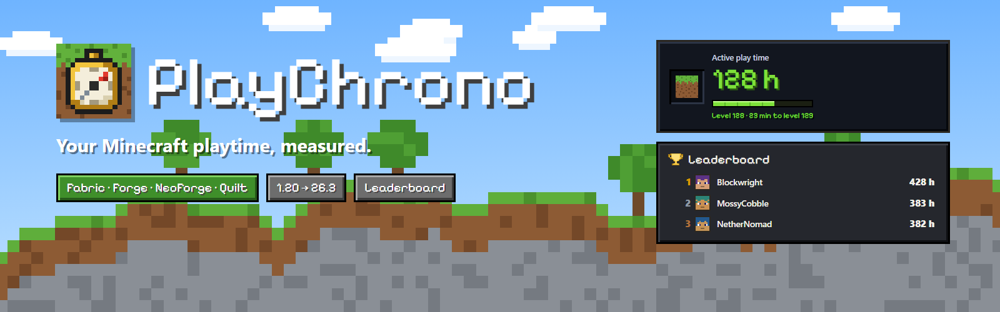

<p align="center"></p>

# PlayChrono — ton temps de jeu Minecraft, mesuré

*[English version](README.md)*

PlayChrono mesure **tout** ce qui concerne ton temps de jeu Minecraft et l'affiche dans un tableau de bord web
local, en 10 langues. Un seul fichier `.jar` fonctionne sur **Fabric, Quilt, Forge et NeoForge, de Minecraft 1.20
à 26.3** (et devrait survivre aux versions suivantes, voir [Compatibilité](#compatibilité)).

- **100 % local** : chaque joueur ne voit que ses propres données, stockées sur son PC (`~/.playchrono/`). Sans le
  classement (facultatif), le mod n'envoie jamais tes stats sur Internet ; il télécharge seulement ton skin chez Mojang
  une fois par jour pour afficher ta tête (`dashboard.skin=false` pour le désactiver).
- Ton pseudo et ta tête Minecraft s'affichent en haut à droite du tableau de bord.
- Appuie sur **F8** en jeu pour ouvrir ton tableau de bord.
- Les stats commencent au premier lancement avec le mod. En option (`import.logs=true`), une **estimation** de
  ton historique passé peut être reconstruite depuis les logs du jeu (`.minecraft`, Prism, Modrinth App, CurseForge).

## Ce qui est mesuré

| Catégorie | Données |
|---|---|
| Temps | jeu ouvert, **temps actif** (dans un monde, fenêtre au premier plan, pas AFK), **AFK** (5 min sans clavier/souris, configurable, compté rétroactivement), fenêtre en arrière-plan, sessions, série de jours, record |
| Horaires | frise heure par heure de chaque journée, carte de chaleur jour×heure, calendrier annuel, heure de début / fin habituelle, part de nuit et de week-end, chronotype |
| Écrans (28 états) | écran titre, liste des serveurs, liste des mondes, options, mods, chargements, reconnexion… et en jeu : inventaire, coffres, chat, pause, livres, panneaux, progrès, lit, mort, générique… + le nom exact de chaque écran (y compris ceux des autres mods) |
| Serveurs & mondes | temps actif / AFK / ouvert par serveur, monde solo, Realms ou LAN ; connexions, morts, ping moyen, joueurs en ligne max, version et logiciel du serveur (Paper, Fabric…), raisons des déconnexions, comptes Minecraft utilisés |
| Versions | temps par version de Minecraft (snapshots compris), par loader, évolution mois par mois, liste des mods installés |
| Exploration | distance par mode (marche, sprint, nage, élytres, vol, monture…), par dimension, biomes visités (collection), météo et heure du jeu pendant que tu joues, modes de jeu, records (Y max/min, distance à 0,0, vitesse max), dégâts reçus, niveaux gagnés, nuits dormies, journal des morts avec coordonnées |
| Clavier & souris | carte de chaleur du clavier, clics gauche/droit, distance parcourue par la souris, actions par minute, sauts, changements de slot, messages envoyés, **commandes les plus utilisées** (nom seulement, jamais les arguments), captures d'écran |
| Performances | FPS moyens / minimum / distribution, gels de plus d'1 s, RAM max, temps de démarrage du jeu, temps de connexion à un monde, configuration (CPU, GPU, RAM, Java, résolution, distance d'affichage, launcher) |
| Fiche serveur | Première connexion, sessions, plus longue session, jours joués, ping, joueurs en ligne, morts, biomes, heures et sessions récentes, par serveur ou monde |
| Classement | 20 stats classées face à tous les joueurs inscrits, avec ton rang dans chacune |
| Stats insolites | part des messages de mort aperçus dans le chat qui parlaient de toi, ta façon préférée de mourir, ce qui tue le plus autour de toi, tes sauts empilés en tours Eiffel, ton temps AFK en films, tes heures à ranger des coffres, lignes lues par message écrit… |

Langues (jeu + tableau de bord) : français, anglais, espagnol, allemand, italien, portugais, polonais, russe,
chinois, japonais. La langue suit celle du jeu automatiquement.

## Installation

1. Prends `release/playchrono-1.1.0.jar`.
2. Mets-le dans le dossier `mods/` de ton instance (Fabric, Quilt, Forge ou NeoForge, 1.20 → 26.3).
   **Aucune dépendance** : pas besoin de Fabric API.
3. Lance le jeu. Le tableau de bord se trouve dans `~/.playchrono/dashboard/index.html`
   (sous Windows : `C:\Users\<toi>\.playchrono\dashboard\index.html`). En jeu : **F8**.

Sans lancer le jeu, le jar sert aussi d'outil en ligne de commande (Java 17+) :

```
java -jar playchrono-1.1.0.jar                  # importe tous tes logs, génère et ouvre le tableau de bord
java -jar playchrono-1.1.0.jar serve            # tableau de bord en direct sur http://127.0.0.1:47823
java -jar playchrono-1.1.0.jar import <dossier> # importe un dossier de jeu précis (son sous-dossier logs/)
java -jar playchrono-1.1.0.jar export stats.json
java -jar playchrono-1.1.0.jar backup [dossier|fichier.zip]   # par défaut : backup.dir, sinon le dossier courant
java -jar playchrono-1.1.0.jar restore <sauvegarde.zip|dossier>  # fusionne une sauvegarde (ferme le jeu avant)
```

## Sauvegarde et nouveau PC

Tes stats n'existent que dans `~/.playchrono/`, sur ce PC. Pour les garder après un changement de PC ou une
réinstallation :

- **Sauvegarde automatique** : indique dans `config.properties` un dossier qui survivra à ce PC (OneDrive, Google
  Drive, une clé USB…), par exemple `backup.dir=C:\Users\toi\OneDrive\PlayChrono`. Un `.zip` complet y est écrit une
  fois par jour et à chaque fermeture du jeu ; les 10 plus récents sont gardés (`backup.keep`).
- **Sauvegarde à la main** : *Télécharger une sauvegarde* en bas de la vue d'ensemble du tableau de bord (F8), ou
  `java -jar playchrono-1.1.0.jar backup`. Le tableau de bord te prévient quand rien ne protège tes stats.
- **Restaurer** : installe PlayChrono sur le nouveau PC, dépose le `.zip` dans `~/.playchrono/restore/` et lance le
  jeu ; un message le confirme dans le chat. Ou bien `java -jar playchrono-1.1.0.jar restore sauvegarde.zip` ; un
  ancien dossier `.playchrono` copié depuis un autre disque marche aussi.

Une restauration **fusionne** et n'écrase jamais rien : les sessions manquantes sont ajoutées, une session présente
des deux côtés garde sa copie la plus complète, les réglages que tu n'as pas changés sur le nouveau PC sont repris de
la sauvegarde, et la date « suivi depuis » revient à ta première installation. La clé de signature de l'ancienne
installation est reprise, donc l'historique restauré compte toujours pour le classement. Restaurer deux fois la même
sauvegarde ne change rien.

Pour les utilisateurs avancés : la variable d'environnement `PLAYCHRONO_DIR` (ou `-Dplaychrono.dir=`) déplace tout le
dossier de données, par exemple directement dans un dossier synchronisé.

## Classement en ligne

L'onglet **Classement** te compare à tous les joueurs PlayChrono inscrits sur 20 stats : temps de jeu total, 7 et
30 derniers jours, séries, plus longue session, distance, vol en élytres, biomes, serveurs, versions, sauts,
actions par minute, morts, altitude max, point le plus éloigné, vitesse max, niveaux d'XP et messages.

- **Opt-in** : rien n'est publié tant que tu ne cliques pas sur *Rejoindre le classement* (F8 › Classement). Tu peux
  partir quand tu veux : ton entrée est alors supprimée du serveur.
- **Ce que garde le serveur** : ton pseudo, ton UUID, les 20 totaux, tes serveurs publics les plus joués et tes versions
  (mod, Minecraft, loader), avec leur historique. Aucune adresse IP.
- **Compté à partir de l'installation du mod**, mesuré en direct. Les estimations tirées des logs ne comptent jamais.
- **Comptes vérifiés** : ton jeu prouve ton identité à Mojang exactement comme pour rejoindre un serveur ; le jeton
  d'accès ne part que chez Mojang. Personne ne peut publier sous ton pseudo, et les comptes hors ligne ne participent pas.
- **Contrôles de cohérence** sur le serveur (le temps de jeu ne peut pas grandir plus vite que l'horloge, chaque stat
  doit progresser en proportion du temps joué, valeurs plafonnées, limites de débit, bannissement).
- **Hors ligne** : si le serveur est injoignable, l'onglet affiche simplement tes propres records, et tout le reste
  fonctionne comme toujours, en local.
- **Journaux signés** : chaque ligne écrite par le mod est signée avec une clé propre à ton installation ; une session
  modifiée à la main reste visible dans ton tableau de bord mais ne compte jamais pour le classement. Le dossier de
  données n'est lisible que par ton compte Windows/macOS/Linux.
- **Serveurs les plus joués** : les serveurs publics classés selon le temps cumulé de tous les joueurs (les adresses
  LAN et privées ne quittent jamais ton ordinateur ; `privacy.serverAddresses=false` les garde toutes privées).


## Configuration

`~/.playchrono/config.properties` (créé au premier lancement, commun à toutes tes instances) :

| Clé | Défaut | Rôle |
|---|---|---|
| `afk.seconds` | `300` | inactivité avant AFK |
| `language` | `auto` | `auto` = langue du jeu, sinon `fr`, `en`, `es`, `de`, `it`, `pt`, `pl`, `ru`, `zh`, `ja` |
| `dashboard.hotkey` | `F8` | touche du tableau de bord (`F1`…`F12` ou `none`) |
| `dashboard.port` | `47823` | serveur local (127.0.0.1 uniquement), `0` = désactivé |
| `chat.welcome` | `true` | résumé du jour dans le chat à la première connexion de la journée (visible par toi seul) |
| `chat.milestones` | `true` | message tous les 10 h de jeu |
| `chat.afkReturn` | `false` | message au retour d'un long AFK |
| `chat.breakReminderMinutes` | `0` | rappel de pause après N minutes de jeu continu |
| `dashboard.seasonal` | `true` | thèmes de Noël (10-29 déc.), du Nouvel An (30 déc.-2 janv.), de Pâques (dimanche de Pâques) et d'Halloween (10 oct.-2 nov.) |
| `chat.seasonal` | `true` | un petit message dans le chat une fois par fête, avec le résumé du jour |
| `dashboard.skin` | `true` | affiche ta tête (skin téléchargé chez Mojang une fois par jour) |
| `leaderboard.enabled` | `false` | participation au classement en ligne (aussi un bouton dans le tableau de bord) |
| `import.logs` | `false` | `true` = ajoute une estimation de l'historique passé, reconstruite depuis les logs |
| `privacy.commands` / `privacy.keys` / `privacy.serverAddresses` | `true` | désactive le comptage des commandes, des touches, ou le stockage des adresses de serveurs |
| `backup.dir` | *(vide)* | dossier de sauvegarde automatique (OneDrive, clé USB…), chaque jour et à la fermeture du jeu ; vide = désactivé. Un chemin Windows peut être collé tel quel |
| `backup.keep` | `10` | nombre de sauvegardes gardées dans `backup.dir` |

## Compatibilité

Le mod ne contient **ni mixin ni dépendance à un loader ou à Minecraft**. Un thread en arrière-plan demande au
thread principal de Minecraft, via son propre `Executor`, d'exécuter ~40 fois par seconde une lecture seule de
l'état du jeu, par réflexion. Les noms des classes et méthodes viennent d'une table
([`names.tsv`](mod/src/main/resources/playchrono/names.tsv)) **générée à partir des mappings officiels** de chaque
version :

| Environnement | Noms à l'exécution | Vérifié |
|---|---|---|
| Fabric / Quilt 1.20 → 1.21.11 | intermediary | mappings des 19 versions + **jeu réel 1.21.8 et 1.21.10** |
| Forge 1.20 → 1.20.4, NeoForge 20.2 → 20.4 | SRG | mappings MCPConfig 1.20 → 1.20.4 |
| Forge 1.20.6+, NeoForge 20.5+ | Mojang | mappings Mojang |
| Tous les loaders en 26.x (jeu non obfusqué) | Mojang | **jeu réel 26.1, 26.2, 26.3** |

Le rapport complet version par version est dans [`tools/mappings/REPORT.md`](tools/mappings/REPORT.md). Quand un
membre change de nom selon la version (l'écran actif passé dans `Gui` en 26.2, le handle de fenêtre renommé en
1.21.9…), le code a un chemin alternatif. Quand quelque chose manque, la donnée concernée est simplement ignorée et
le reste continue de fonctionner.

**Quand une nouvelle version de Minecraft sort :**

```
cd tools/mappings
python -I fetch.py        # télécharge les mappings / jars officiels de toutes les versions >= 1.20
python -I generate.py     # régénère names.tsv + screens.tsv + REPORT.md
cd ../../mod && java Build.java
java -cp build/classes tools/ReflectionCheck.java <jar du jeu> <dossier libraries>   # vérification sur le vrai jeu
```

## Compiler

Seul un JDK 17+ est nécessaire, sans Gradle :

```
cd mod
java Build.java                                         # -> release/playchrono-<version>.jar (~2 s)
java -cp build/classes tools/TrackerSimulation.java     # test de bout en bout de la comptabilité du temps
```

Les métadonnées (nom, version, auteurs, liens) se changent dans [`mod/mod.properties`](mod/mod.properties), qui
génère `fabric.mod.json`, `META-INF/mods.toml` et `META-INF/neoforge.mods.toml`.

## Structure

```
mod/            le mod (Java 17, sans dépendance) + Build.java + outils de test
  src/main/java/dev/playchrono/
    probe/      lecture de l'état du jeu (thread principal) + clavier/souris via GLFW
    track/      comptabilité du temps, AFK rétroactif, compteurs, événements
    store/      journal par session (JSONL), compactage, agrégation, totaux du classement, import des logs
    web/        tableau de bord local, mini-serveur 127.0.0.1
    reflect/    accès réflexif multi-version
  src/stubs/    signatures de compilation uniquement (Fabric, Forge, NeoForge, GLFW), jamais embarquées
web/            tableau de bord (HTML/CSS/JS sans dépendance), embarqué dans le jar
tools/mappings/ génération et vérification de la table de noms
docs/           format des données, publication
```

## Limites, en toute franchise

- **Historique importé** : les logs ne disent ni quand tu étais AFK ni dans quel menu tu étais. Le temps passé sur
  un serveur compte donc comme du jeu, et la version est souvent inconnue pour le launcher officiel (connue pour
  Fabric, Forge et les instances Prism). Le tableau de bord le signale par un bandeau.
- **Clavier et souris** sont lus 40 fois par seconde. Un appui extrêmement bref (< 25 ms) peut être manqué : ça
  n'a aucun effet sur l'AFK, mais les compteurs de touches sont légèrement sous-estimés.
- **Messages de chat** : seul le nombre de messages envoyés et reçus est mesuré (pas leur contenu). Pour les
  commandes, seul le nom est conservé ; pour les messages de mort, seule la clé de cause du jeu (`attack.lava`), jamais
  qui est mort ni le texte. Une mort annoncée par un plugin en texte libre (sans message vanilla) n'est pas reconnue.
- Si deux instances du jeu tournent en même temps, le temps « jeu ouvert » s'additionne. Le temps **actif**, lui,
  ne compte qu'une fenêtre au premier plan à la fois.

## Licence

[GPL-3.0](LICENSE) © 2026 Loxxy91. Tu peux étudier, modifier et partager PlayChrono, à condition que les copies et
versions modifiées restent sous GPL-3.0, gardent cette mention et citent le projet d'origine. Pas un produit officiel
Minecraft, ni approuvé par Mojang ou Microsoft, ni associé à eux.
