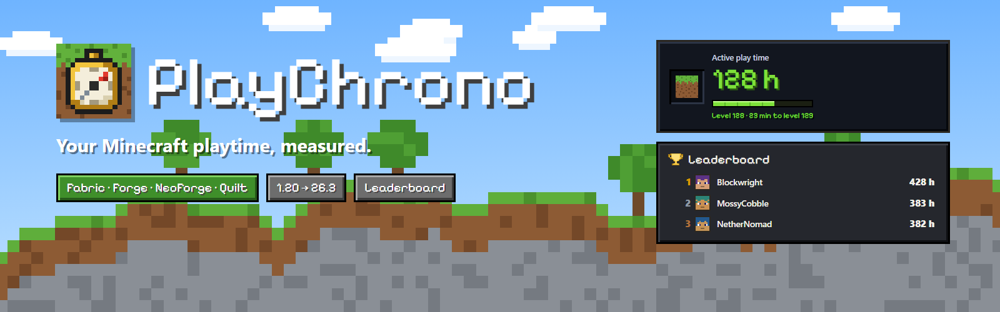
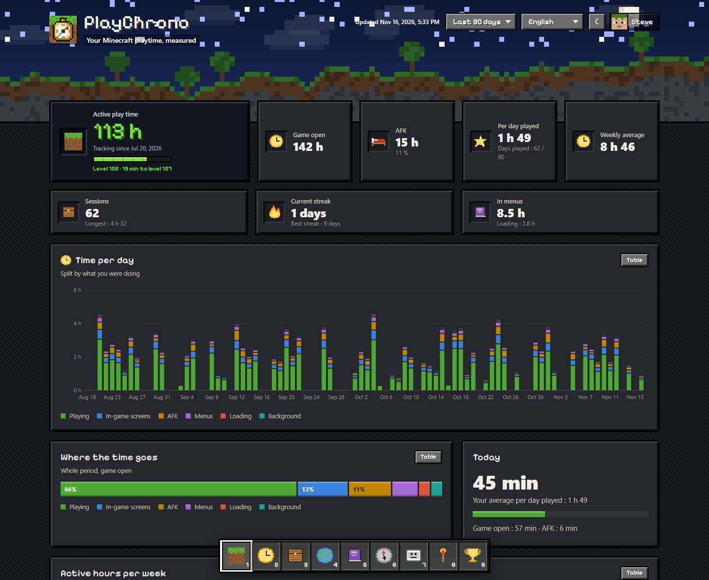
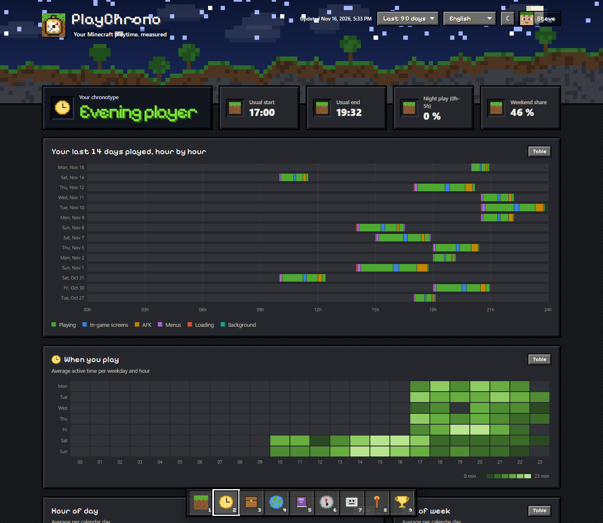
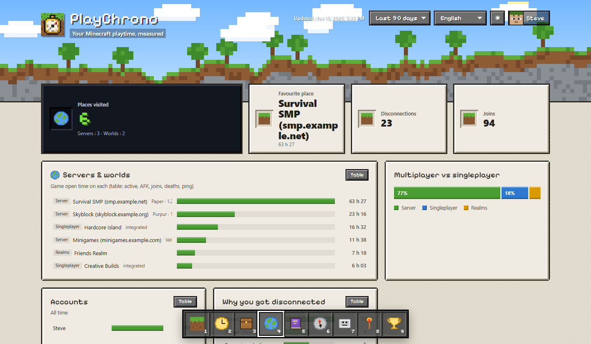
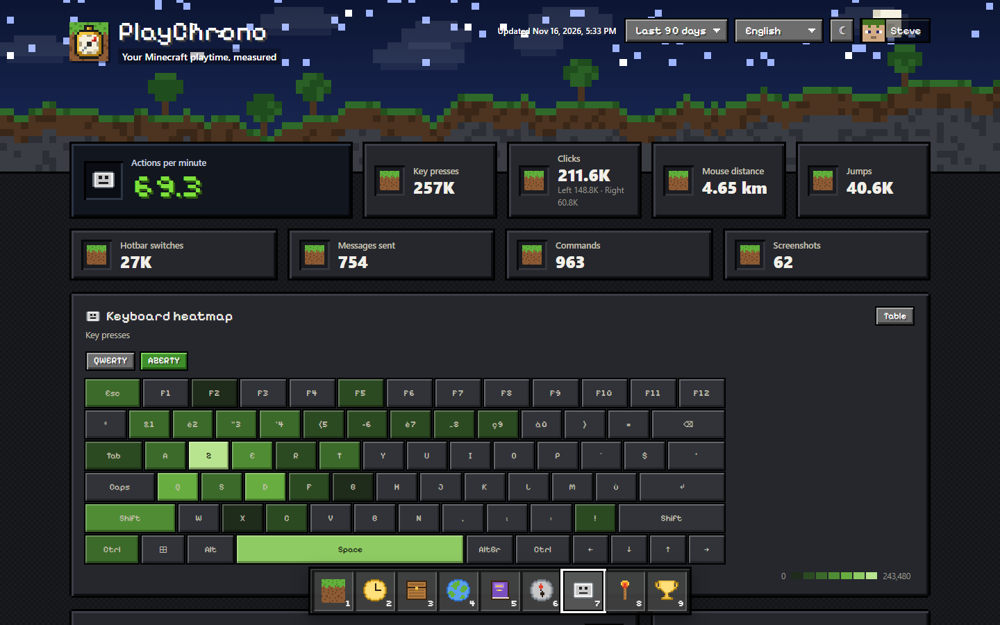
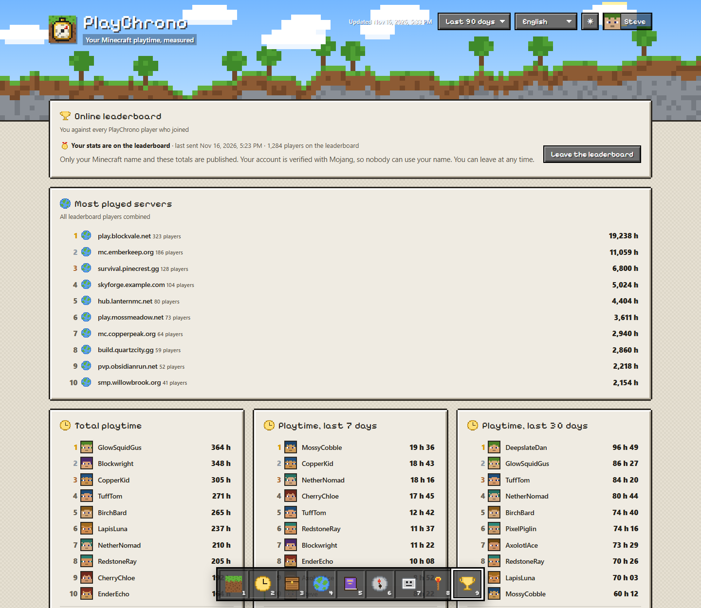
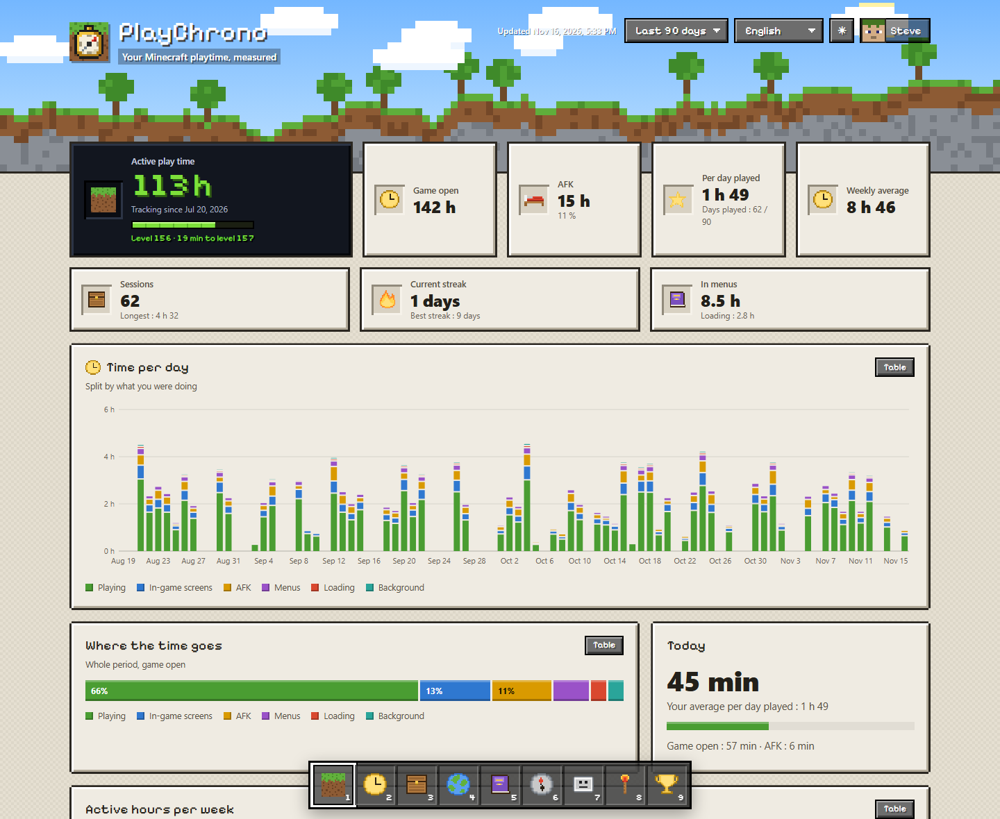
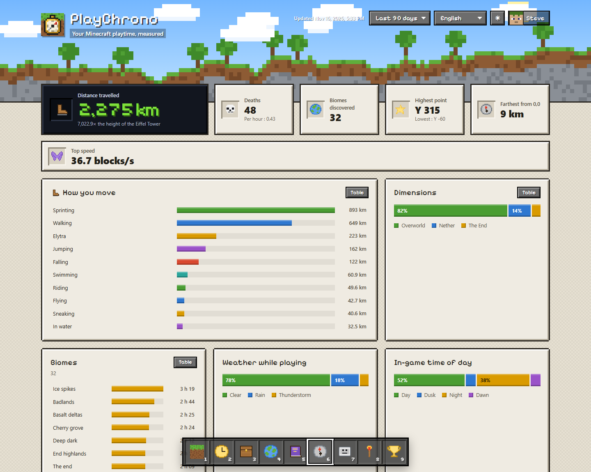
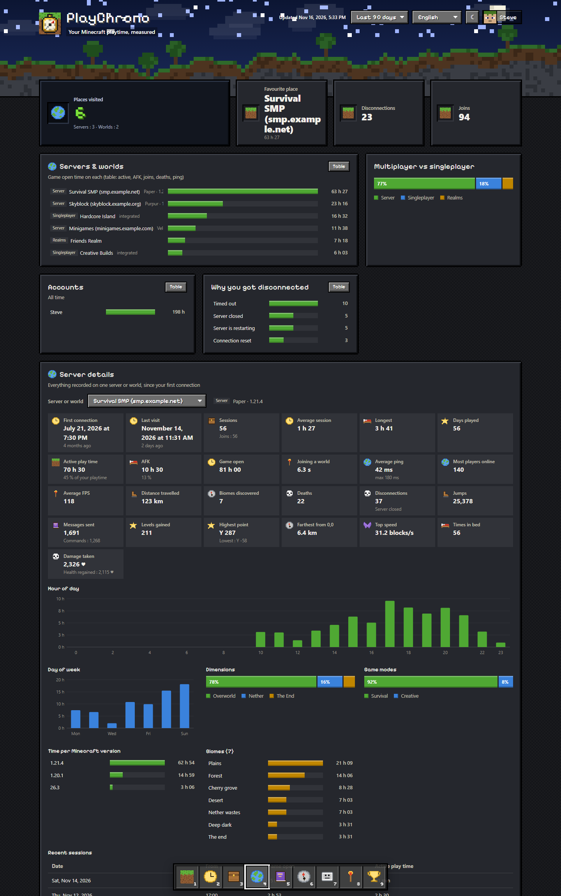
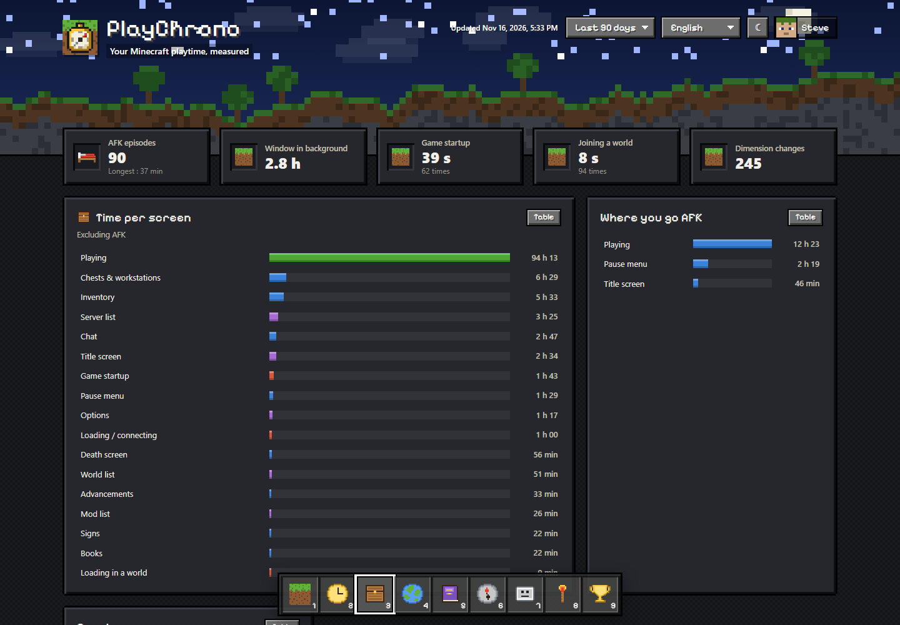

<p align="center">
  
</p>

<p align="center">
  <a href="https://github.com/Loxxy91/playchrono/releases/latest"></a>
  
  
  
  <a href="LICENSE"></a>
</p>

<p align="center">
  <b>Your Minecraft playtime, measured.</b><br>
  Active vs AFK time, schedules, servers, versions, movement, inputs and 100+ stats in a local dashboard. Press <kbd>F8</kbd>.
</p>

<p align="center">
  <a href="#-installation">Installation</a> ·
  <a href="#-features">Features</a> ·
  <a href="#-privacy">Privacy</a> ·
  <a href="#%EF%B8%8F-configuration">Configuration</a> ·
  <a href="#-how-it-works">How it works</a> ·
  <a href="#-building-from-source">Build</a> ·
  <a href="README.fr.md">Français</a>
</p>

---

<p align="center">
  
</p>

## ✨ Why PlayChrono

- **One jar, every setup.** Fabric, Quilt, Forge and NeoForge, Minecraft **1.20 to 26.3**, with no dependencies
  (no Fabric API needed).
- **Honest numbers.** You only count as playing when you are in a world, the window is focused and you are not
  AFK. After 5 minutes without input, the whole idle stretch is retroactively reclassified as AFK.
- **Feels like the game.** Block-landscape header, bevelled panels, item-slot tiles, a hotbar to navigate (keys 1-9),
  smooth animations, day and night themes, 10 languages, live refresh while you play.
- **An online leaderboard** (opt-in, Mojang-verified) to compare with every player, and your own stats always work offline.
- **Private by default.** Your stats stay on your computer. Only if you join the leaderboard are your name and totals published.
- **Seasonal themes.** Snow at Christmas, fireworks for the New Year, eggs at Easter, pumpkins at Halloween, every year.
- **Your face on it.** Your Minecraft name and head are shown in the top-right corner of the dashboard.
- **Zero impact on your game.** No mixins and no code injection: a read-only probe plus background bookkeeping.

## 📥 Installation

1. Download `playchrono-1.0.0.jar` from the [latest release](https://github.com/Loxxy91/playchrono/releases/latest).
2. Drop it into the `mods` folder of any Fabric, Quilt, Forge or NeoForge instance (1.20 or newer).
3. Play, then press <kbd>F8</kbd> to open your dashboard. You can also open
   `~/.playchrono/dashboard/index.html` at any time, even with the game closed.

> [!TIP]
> One stats folder is shared by every instance and launcher on your computer, so all your playtime ends up in the
> same dashboard.

## 📊 Features

| | |
|---|---|
| ⏱️ **Time** | Game open, active, AFK, background, sessions, daily streaks, records |
| 🗓️ **Schedule** | Hour-by-hour timeline of each day, weekday × hour heatmap, year calendar, usual start and end, chronotype |
| 🖥️ **28 screen states** | Title screen, server list, options, loading… and in game: inventory, chests, chat, pause, books, signs, bed, death screen, plus the exact screen class (other mods included) |
| 🌍 **Servers & worlds** | Time per server, singleplayer world, Realm or LAN; joins, deaths, average ping, server software, disconnect reasons, accounts used |
| 🧩 **Versions** | Time per Minecraft version (snapshots included) and per loader, month by month, installed mods |
| 🧭 **Exploration** | Distance per movement mode, dimensions, biome collection, weather, in-game time of day, records, death log with coordinates |
| ⌨️ **Inputs** | Keyboard heatmap, clicks, mouse distance, actions per minute, jumps, favourite commands (name only), screenshots |
| ⚙️ **Performance** | FPS average, minimum and distribution, freezes, peak RAM, startup and world-join times, your setup |
| 🧭 **Server details** | First connection, sessions, longest session, days played, ping, players online, deaths, biomes, hours and recent sessions, per server or world |
| 🏆 **Leaderboard** | 20 ranked stats against every player who joined, with your rank in each |

Languages: English, Français, Español, Deutsch, Italiano, Português, Polski, Русский, 中文, 日本語. The language
follows your game language.

<details>
<summary><b>📸 More screenshots</b></summary>
<br>

| Schedule | Servers & worlds |
|---|---|
|  |  |
| **Keyboard heatmap** | **Leaderboard** |
|  |  |
| **Light theme** | **Exploration** |
|  |  |
| **Server details** | **Activity** |
|  |  |

<sub>Screenshots use a fictional demo player (<code>branding/demo/make_demo.py</code>).</sub>
</details>

## 🏆 Online leaderboard

The **Leaderboard** tab ranks you against every PlayChrono player who joined, on 20 stats: total playtime, last 7 and
30 days, streaks, longest session, distance, elytra flight, biomes, servers, versions, jumps, actions per minute,
deaths, highest altitude, farthest point, top speed, XP levels and messages.

- **Opt-in**: nothing is published until you click *Join the leaderboard* (F8 › Leaderboard). Leaving it at any time
  deletes your entry from the server.
- **Counted from the day you install the mod**, measured live by the mod. Optional log estimates never count.
- **Verified accounts**: your game proves your identity to Mojang exactly like when joining a server; the access
  token only ever goes to Mojang. Nobody can post under your name, and offline accounts can't take part.
- **Plausibility checks** on the server (playtime can't grow faster than real time, every stat must grow in
  proportion to the playtime added, capped values, rate limits, bans).
- **Signed journals**: each line the mod writes is signed with a key unique to your install; a hand-edited session
  still shows in your own dashboard but never counts for the leaderboard. The data folder is private to your OS account.
- **Most played servers**: public servers ranked by the total time of every player (LAN and private addresses never
  leave your computer; `privacy.serverAddresses=false` keeps all of them private).
- **Offline-proof**: if the server can't be reached, the tab simply shows your own records, and all other stats
  keep working, as always 100% locally.


## 🔒 Privacy

- Everything is stored in `~/.playchrono/` on your computer. Without the (opt-in) leaderboard, PlayChrono **never sends
  your stats over the internet**. The only other request downloads your own skin from Mojang, once a day, to show your
  head in the dashboard (`dashboard.skin=false` turns it off).
- If you join the leaderboard, its server stores what your game sends: your name, UUID, the 20 totals, your most
  played public servers and your mod / Minecraft / loader versions, with their history. No IP address is kept.
  Leaving the leaderboard deletes all of it.
- The live dashboard server only listens on `127.0.0.1` and rejects foreign `Host` headers, so other devices
  and websites cannot read it.
- Chat content and command arguments are **never** recorded: only message counts and command names.
- Per-key counts, command names and server addresses can each be turned off.

## ⚙️ Configuration

`~/.playchrono/config.properties` is created on first launch and shared by all instances.

| Key | Default | Description |
|---|---|---|
| `afk.seconds` | `300` | Inactivity before you count as AFK |
| `language` | `auto` | `auto` follows the game, or `en`, `fr`, `es`, `de`, `it`, `pt`, `pl`, `ru`, `zh`, `ja` |
| `dashboard.hotkey` | `F8` | `F1`…`F12`, or `none` |
| `dashboard.port` | `47823` | Live dashboard on `127.0.0.1`; `0` disables it |
| `chat.welcome` | `true` | Daily summary in chat on your first world join (only you see it) |
| `chat.milestones` | `true` | A message every 10 hours of play |
| `chat.afkReturn` | `false` | A message when you come back from a long AFK |
| `chat.breakReminderMinutes` | `0` | Break reminder after N minutes of continuous play |
| `dashboard.seasonal` | `true` | Christmas (10-29 Dec), New Year (30 Dec-2 Jan), Easter (Easter Sunday) and Halloween (10 Oct-2 Nov) themes |
| `chat.seasonal` | `true` | A friendly message in chat once per event, with the daily summary |
| `dashboard.skin` | `true` | Show your own head (skin downloaded from Mojang once a day) |
| `leaderboard.enabled` | `false` | Opt-in to the online leaderboard (also a button in the dashboard) |
| `import.logs` | `false` | Adds an *estimate* of past playtime rebuilt from the game's logs |
| `privacy.commands` · `privacy.keys` · `privacy.serverAddresses` | `true` | Turn off command names, per-key counts or server addresses |

### Command line

The jar is also a small CLI (Java 17+), handy to look at your stats without starting the game:

```bash
java -jar playchrono-1.0.0.jar                  # build and open the dashboard
java -jar playchrono-1.0.0.jar serve [port]     # live dashboard on http://127.0.0.1:47823
java -jar playchrono-1.0.0.jar import <gameDir> # import the logs/ folder of a game directory
java -jar playchrono-1.0.0.jar export stats.json
```

## 🛠 How it works

PlayChrono has **no mixins and no compile-time dependency** on Minecraft or on any loader. A low-priority
background thread asks Minecraft's own main-thread `Executor` to run a read-only probe about 40 times per
second. Keyboard and mouse activity is read straight from GLFW, and everything else (accounting, counters, files)
happens off the main thread.

Runtime names come from a table ([`names.tsv`](mod/src/main/resources/playchrono/names.tsv)) **generated from
the official mappings** of every release since 1.20:

| Environment | Runtime names | Verified against |
|---|---|---|
| Fabric / Quilt 1.20 → 1.21.11 | intermediary | mappings for 19 releases, **real game 1.21.8 and 1.21.10** |
| Forge 1.20 → 1.20.4, NeoForge 20.2 → 20.4 | SRG | MCPConfig mappings |
| Forge 1.20.6+, NeoForge 20.5+ | Mojang | Mojang mappings |
| Every loader on 26.x (unobfuscated) | Mojang | **real game 26.1, 26.2 and 26.3** |

When a member changes between versions, the code has an alternative path. When something is missing, only that
stat is skipped. See [`tools/mappings/REPORT.md`](tools/mappings/REPORT.md) for the per-version matrix and
[`docs/DATA_FORMAT.md`](docs/DATA_FORMAT.md) for the file formats.

## 🧱 Building from source

Only a JDK 17+ is needed, no Gradle:

```bash
cd mod
java Build.java                                       # -> release/playchrono-<version>.jar (~2 s)
java -cp build/classes tools/TrackerSimulation.java   # end-to-end test of the time accounting
```

Supporting a new Minecraft version:

```bash
cd tools/mappings
python -I fetch.py      # official mappings / client jars for every release >= 1.20
python -I generate.py   # regenerates names.tsv, screens.tsv and REPORT.md
cd ../../mod && java Build.java
java -cp build/classes tools/ReflectionCheck.java <client jar> <libraries dir>
```

<details>
<summary><b>Project layout</b></summary>

```
mod/              the mod (Java 17, no dependencies), Build.java, test tools
  src/main/java/dev/playchrono/
    probe/        read-only game probe (main thread), keyboard/mouse via GLFW
    track/        time accounting, retroactive AFK, counters, events
    store/        per-session JSONL journal, compaction, aggregation, leaderboard totals, log importer
    web/          local dashboard, hardened 127.0.0.1 server, leaderboard client
    reflect/      cross-version reflection
  src/stubs/      compile-only signatures (Fabric, Forge, NeoForge, GLFW), never packaged
web/              dashboard (dependency-free HTML/CSS/JS, embedded in the jar)
tools/mappings/   name-table generation and coverage report
branding/         icon, banner, screenshots, store listing
docs/             data format, publishing guide
```
</details>

## 🤝 Contributing

Bug reports and pull requests are welcome. See [CONTRIBUTING.md](CONTRIBUTING.md). When reporting a bug,
please attach the `[PlayChrono]` lines of your `logs/latest.log`.

## 📄 License

[GPL-3.0](LICENSE) © 2026 Loxxy91. You may study, change and share PlayChrono, as long as copies and modified
versions stay under the GPL-3.0, keep this notice and credit the original project. Not an official Minecraft product. Not approved by or associated with Mojang
or Microsoft.
